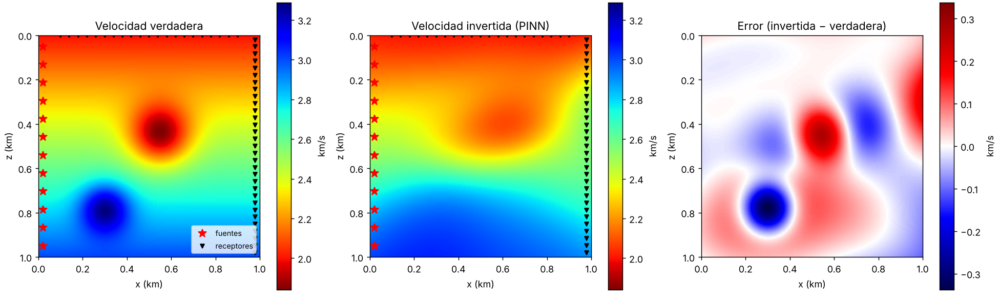
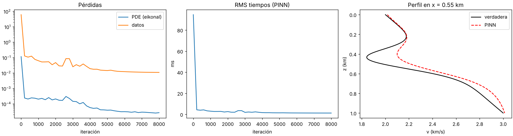
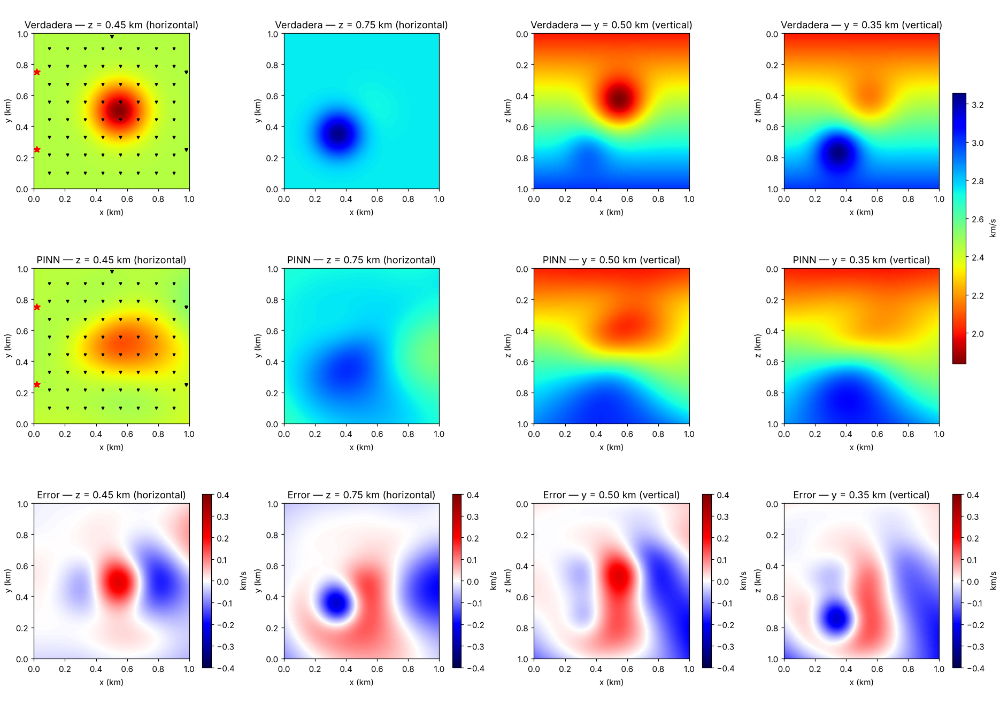
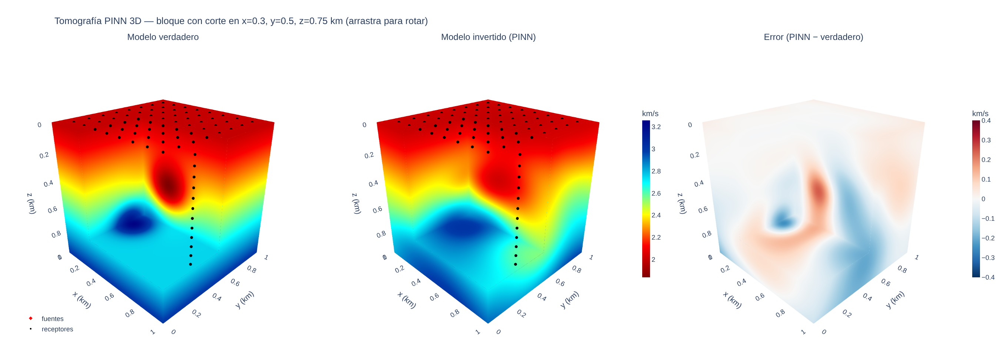

# Tomografía sísmica de tiempos de viaje con PINN

Inversión de un modelo de velocidad 2D a partir de tiempos de primera llegada usando una
**red neuronal informada por la física (PINN)** que resuelve la ecuación eikonal
(enfoque tipo *PINNtomo*, Waheed et al., 2021).

## Física

Ecuación eikonal: `|∇T(x; xs)| = 1 / v(x)`.

Se usa la forma **factorizada** `T = T0 · τ`, con `T0 = |x − xs|`. Así la condición de
fuente `T(xs) = 0` se cumple por construcción y la singularidad del frente de onda en la
fuente queda absorbida en `T0`.

Dos redes se entrenan **a la vez**:

| Red | Entrada | Salida |
|-----|---------|--------|
| `tau_net` | `(x, z, xs, zs)` | `τ > 0` → tiempo de viaje para cualquier fuente |
| `v_net`   | `(x, z)`         | `v ∈ [vmin, vmax]` → **modelo de velocidad invertido** |

Pérdida:

```
L = w_pde · ‖ v·|∇T| − 1 ‖²        (residuo eikonal en puntos de colocación aleatorios)
  + w_data · ‖ T(xr; xs) − T_obs ‖²  (tiempos observados en receptores)
  + w_reg · ‖ ∇v ‖²                 (suavizado opcional)
```

No hace falta trazado de rayos ni cálculo de la matriz de sensibilidad: el gradiente
respecto a `v` sale de la diferenciación automática.

## Experimento sintético

* Dominio 1 km × 1 km; velocidad = gradiente vertical (2 → 3 km/s) + anomalía lenta
  (−0.6 km/s) + anomalía rápida (+0.5 km/s).
* Geometría entre pozos: 12 fuentes en el pozo izquierdo, 31 receptores en el derecho y 21
  en superficie → 624 tiempos, con ruido gaussiano de 1 ms.
* Los datos "observados" se generan con Fast Marching de 2º orden (`scikit-fmm`), que
  también se usa para **validar de forma independiente** el modelo invertido.
* Modelo inicial: velocidad constante 2.5 km/s.

### Resultados (configuración por defecto, ~2.5 min en CPU)

| Métrica | Valor |
|---|---|
| RMS tiempos, modelo inicial | 37.8 ms |
| RMS tiempos, modelo PINN (recalculado con FMM) | **1.58 ms** (ruido = 1 ms) |
| Error relativo de velocidad | 2.9 % |




La anomalía lenta y el gradiente se recuperan bien; la anomalía rápida profunda queda
suavizada, como es típico por la cobertura limitada de rayos en geometría entre pozos.

## Versión 3D

`run_tomography_3d.py` hace lo mismo en un cubo de 1 km³ (`pinn_tomo/forward3d.py`):

* Modelo: gradiente vertical + anomalía lenta esférica (−0.6 km/s en (0.55, 0.50, 0.45))
  + anomalía rápida (+0.5 km/s en (0.35, 0.35, 0.75)).
* Geometría: 12 fuentes en 2 pozos; 112 receptores en 3 pozos y una malla 8×8 en
  superficie → **1344 tiempos** con 1 ms de ruido (FMM 3D en malla 161³).
* Las mismas redes con `dim=3`: `tau_net(x, y, z, xs, ys, zs)` y `v_net(x, y, z)`.

| Métrica (3D, 25 000 iteraciones, ~7 min en CPU) | Valor |
|---|---|
| RMS tiempos, modelo inicial | 37.8 ms |
| RMS tiempos, modelo PINN (recalculado con FMM 3D) | **1.15 ms** (ruido = 1 ms) |
| Error relativo de velocidad | 2.0 % |
| Amplitud recuperada, anomalía lenta / rápida | 60 % / 51 % |



#### Cómo se mejoró la anomalía rápida

La anomalía rápida sí está en los datos: cambia hasta 14 ms los tiempos (160 de 1344
tiempos cambian más de 3 ms). Se probaron varias configuraciones (amplitud recuperada en
el centro de cada anomalía):

| Configuración | Rápida | Lenta | RMS FMM |
|---|---|---|---|
| Inicial (10 000 it., `v_net` ancho 48, lr 2e-3) | 28 % | 47 % | 1.73 ms |
| `tau_net` ancho 128 | 31 % | 47 % | 1.70 ms |
| `w_data = 10` | 22 % | 30 % | 2.78 ms |
| `v_net` ancho 96, lr 1e-3 | 34 % | 45 % | 1.73 ms |
| … + Fourier (32, σ = 1.5) | 36 % | 45 % | 1.74 ms |
| … + `tau_net` 128, 20 000 it. | 41 % | 54 % | 1.37 ms |
| **`v_net` 96, lr 1e-3, 25 000 it. (por defecto)** | **51 %** | **60 %** | **1.15 ms** |
| Geometría densa (27 fuentes, `--dense`), 10 000 it. | 21 % | 40 % | 2.27 ms |

La clave fue **entrenar más**: con 10 000 iteraciones la PINN no llegaba a ajustar los
datos al nivel del ruido. La geometría densa necesita aún más iteraciones (su campo de
tiempos es más complejo) y sus datos están en `data/3d_densa/`.

### Bloque 3D

`plot_block_3d.py` dibuja el cubo con un corte en esquina (verdadero, PINN y error) y genera
un HTML interactivo con Plotly (`outputs_3d/bloque_3d.html`: rotar, zoom y valor al pasar
el ratón).



```bash
python plot_block_3d.py                       # corte por defecto en (0.30, 0.50, 0.75) km
python plot_block_3d.py --cut 0.5 0.5 0.45    # otro corte
python plot_block_3d.py --inline-js           # HTML que funciona sin internet
python plot_block_3d.py --local-js --out docs/bloque_3d.html   # actualizar GitHub Pages
```

**Sitio web (GitHub Pages):** la carpeta `docs/` contiene una página con el bloque 3D
interactivo y las figuras. Se publica desde *Settings → Pages → Deploy from a branch →
`main` / `/docs`*.

```bash
python run_tomography_3d.py                 # lee data/3d/ (o lo genera si no existe)
python run_tomography_3d.py --iters 40000          # aún más entrenamiento
python run_tomography_3d.py --dense --iters 40000  # geometría densa (27 fuentes)
```

## Datos

Los datos sintéticos usados están guardados en `data/` (se regeneran con `python export_data.py`):

| Archivo | Contenido |
|---|---|
| `tiempos.csv` | 624 tiempos: `id_fuente, xs_km, zs_km, id_receptor, xr_km, zr_km, t_obs_s, t_sin_ruido_s` |
| `fuentes.csv`, `receptores.csv` | posiciones (km) |
| `modelo_verdadero.npz` | modelo de velocidad verdadero en malla 201×201 (`x_km`, `z_km`, `v_km_s`) |
| `info.json` | descripción, fórmula del modelo, ruido y semilla |
| `3d_densa/` | datos 3D con 27 fuentes (`--dense`) |
| `3d/` | datos 3D: `tiempos.csv` (con columnas `y`), `fuentes.csv`, `receptores.csv`, `info.json` |

## Uso

```bash
pip install -r requirements.txt
python run_tomography.py                       # configuración por defecto
python run_tomography.py --iters 15000         # más entrenamiento
python run_tomography.py --v-fourier 32        # características de Fourier en v_net
python run_tomography.py --noise 0.003 --w-reg 1e-3
```

Salidas en `outputs/`: `velocidad.png`, `entrenamiento.png`, `ajuste_tiempos.png`,
`metrics.json`, `results.npz` y los pesos `model.pt`.

## Estructura

```
data/                  # datos sintéticos guardados
export_data.py         # exporta los datos a data/
pinn_tomo/forward.py   # modelo verdadero, geometría y solver eikonal FMM (datos + validación)
pinn_tomo/pinn.py      # redes tau_net / v_net, residuo eikonal, regularización
pinn_tomo/forward3d.py # versión 3D del modelo, geometría y FMM
run_tomography_3d.py   # inversión 3D
plot_block_3d.py       # bloque 3D interactivo (Plotly)
run_tomography.py      # generación de datos, entrenamiento, evaluación y figuras
```

Para usar datos reales: sustituir `src`, `rec` y `t_obs` en `run_tomography.py` (normalizando
coordenadas al cuadrado [0, 1]²) y ajustar `--vmin/--vmax`.

## Licencia

Distribuido bajo la licencia MIT. Ver [LICENSE](LICENSE).
